<picture>
  <source media="(prefers-color-scheme: dark)" srcset="assets/runner-dark.svg">
  <source media="(prefers-color-scheme: light)" srcset="assets/runner-light.svg">
  
</picture>

I work on privacy-preserving machine learning, federated learning and explainability. Researcher at [Athena Research Center](https://www.athenarc.gr/en/home), working on privacy for federated learning in [EBRAINS](https://www.ebrains.eu/). MSc (valedictorian) from the University of Athens.

#### Recent work
- **[agentic-fuzzing-env](https://github.com/Kallistina/agentic-fuzzing-env)**: a reinforcement learning environment where LLM agents build, fuzz and triage a target over MCP, scored by a tamper-resistant grader.
- **A Typed Tensor Language for Shared-State Federated Computation**: NeurIPS 2026 · [arXiv](https://arxiv.org/abs/2605.21103)
- **Privacy-Preserving Federated SHAP Explanations of Clinical Prediction Models**: my MSc thesis, submitted to PETS 2027 · [thesis](https://pergamos.lib.uoa.gr/en/item/uoadl:5452272)
- **[distributed-SQL-query-engine](https://github.com/Kallistina/distributed-SQL-query-engine)**: a distributed SQL engine built from scratch, with columnar storage and a coordinator-worker design.

#### I work with
Python · C/C++ · PyTorch · Flower · Docker · Linux

#### Contribution game
<picture>
  <source media="(prefers-color-scheme: dark)" srcset="https://raw.githubusercontent.com/Kallistina/Kallistina/output/pacman-contribution-graph-dark.svg">
  <source media="(prefers-color-scheme: light)" srcset="https://raw.githubusercontent.com/Kallistina/Kallistina/output/pacman-contribution-graph.svg">
  
</picture>
