<picture>
  <source media="(prefers-color-scheme: dark)" srcset="assets/contrib3d-dark.svg">
  <source media="(prefers-color-scheme: light)" srcset="assets/contrib3d-light.svg">
  
</picture>

<!-- Pac-Man contribution game, hidden for now. Remove these comment markers to show it again.
<picture>
  <source media="(prefers-color-scheme: dark)" srcset="https://raw.githubusercontent.com/Kallistina/Kallistina/output/pacman-contribution-graph-dark.svg">
  <source media="(prefers-color-scheme: light)" srcset="https://raw.githubusercontent.com/Kallistina/Kallistina/output/pacman-contribution-graph.svg">
  
</picture>
-->
